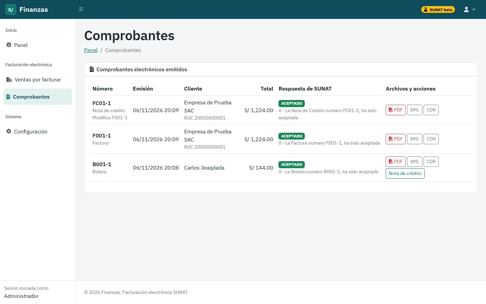
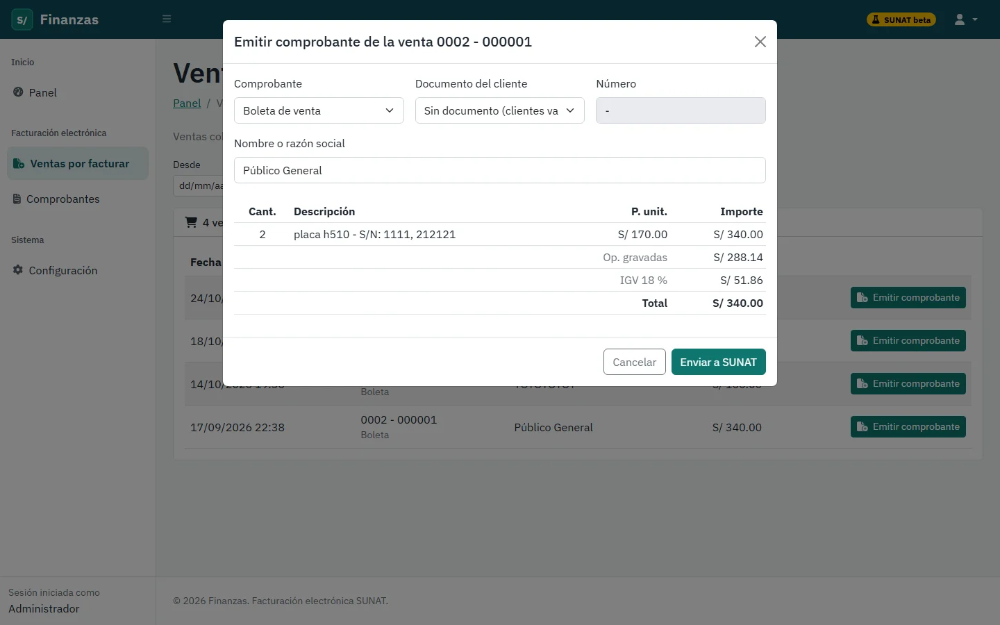
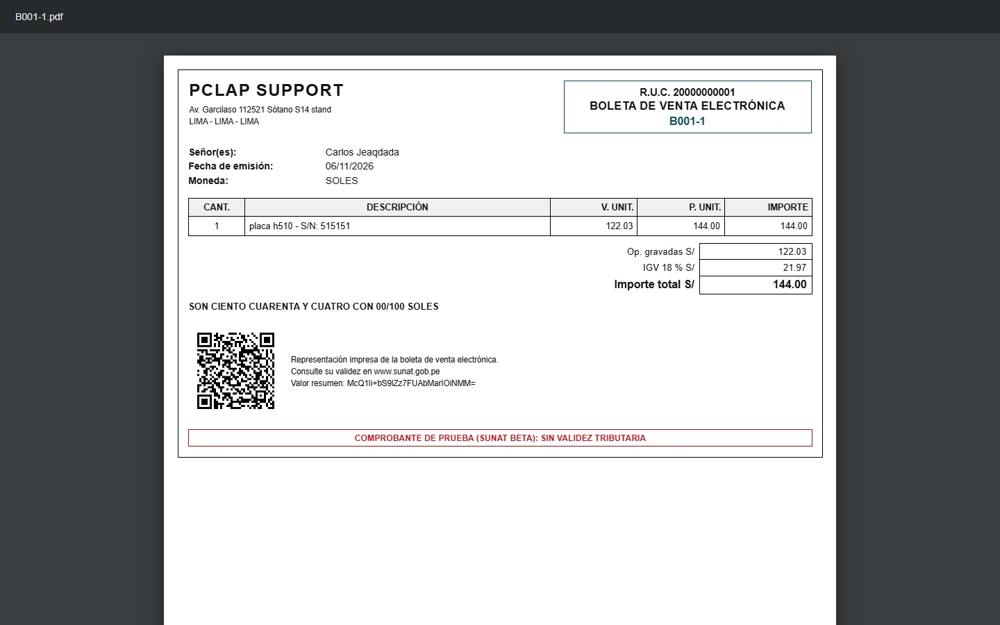
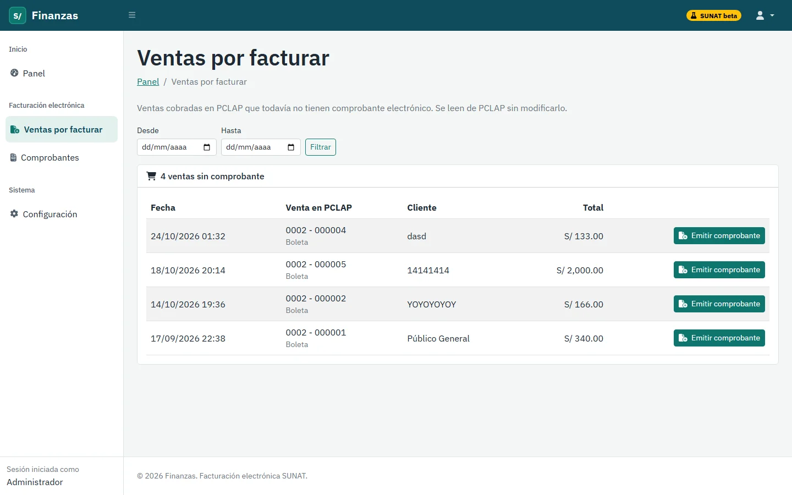
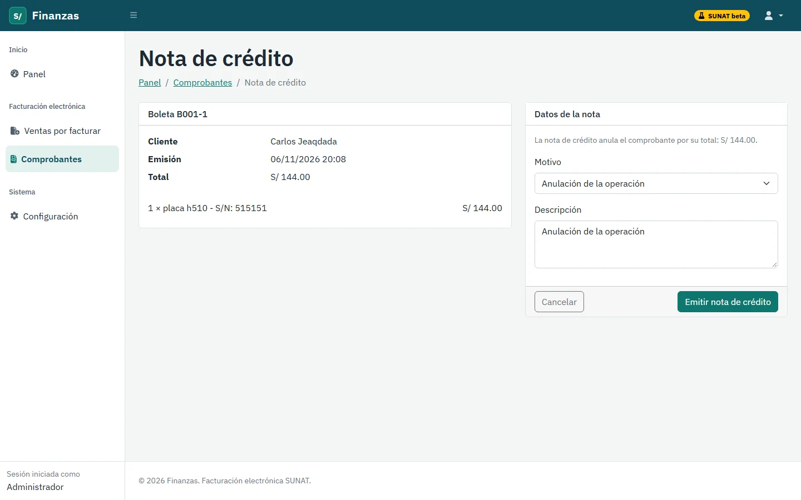
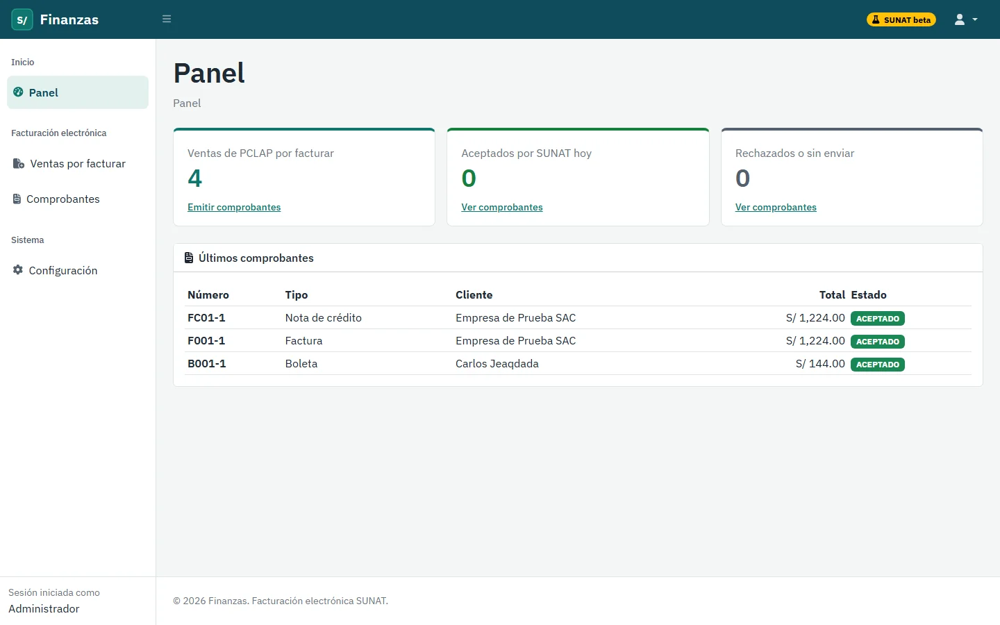
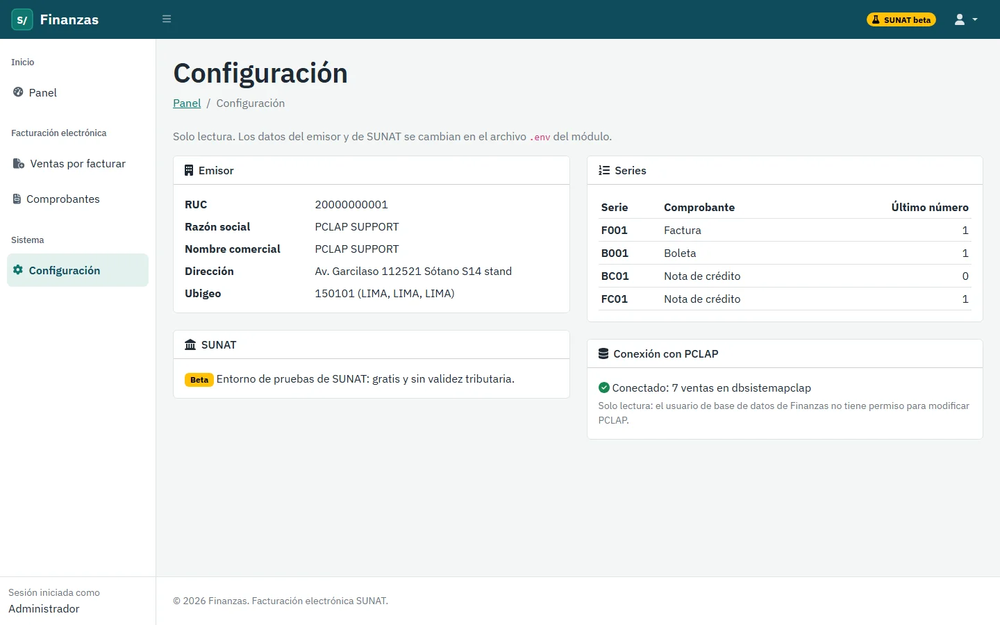

# PCLAP Finanzas

Facturación electrónica para PCLAP SUPPORT, mi tienda de hardware en Lima. Toma las ventas cobradas en PCLAP y las convierte en boletas, facturas y notas de crédito electrónicas: arma el XML, lo firma, lo envía a SUNAT y guarda la respuesta junto con el PDF del comprobante.

Es uno de los tres sistemas de mi ERP:

| Sistema | Qué cubre |
|---|---|
| [PCLAP SUPPORT](https://www.pclap-support.com) | Ventas, compras, inventario y tienda web. En producción. |
| **PCLAP Finanzas** | Este repositorio: facturación electrónica con SUNAT. |
| [PCLAP CRM](https://github.com/NovoaaMaster/pclap-crm) | Clientes, seguimiento y embudo de ventas. |

Funciona con el **entorno de pruebas de SUNAT** (beta): es gratuito y los comprobantes no tienen validez tributaria.



## Qué hace

- **Ventas por facturar.** Lista las ventas cobradas en PCLAP que todavía no tienen comprobante, con filtro por fechas. Sugiere factura si el cliente tiene RUC y boleta en los demás casos.
- **Vista previa antes de enviar.** Muestra el cliente, las líneas con su número de serie, el valor de venta, el IGV de 18 % y el total. Los datos del cliente se pueden corregir, y avisa si el total no coincide con el de PCLAP.
- **Envío a SUNAT.** Genera el XML en formato UBL 2.1, lo firma y lo envía. Cada comprobante queda como aceptado, observado o rechazado, con el código y el mensaje de SUNAT. Si el envío falla, queda en error y se puede reenviar con el mismo número.
- **Descargas.** PDF con código QR, hash y monto en letras; XML firmado; y la constancia de recepción de SUNAT (CDR).
- **Notas de crédito.** Anulan un comprobante aceptado por anulación de la operación, por error en el RUC o por devolución total.
- **Reglas de SUNAT.** La factura exige un RUC de 11 dígitos, el DNI debe tener 8 y una boleta de más de S/ 700 debe identificar al cliente. La numeración de cada serie no tiene saltos ni duplicados, aunque dos personas emitan a la vez.
- **Configuración.** Datos del emisor, modo de SUNAT, series con su último número y estado de la conexión con PCLAP.

## Capturas

| | |
|---|---|
|  |  |
| Vista previa de la boleta antes de enviarla a SUNAT | Boleta en PDF con código QR y monto en letras |
|  |  |
| Ventas de PCLAP que todavía no tienen comprobante | Nota de crédito que anula una boleta |
|  |  |
| Panel con ventas por facturar y últimos comprobantes | Emisor, series y conexión de solo lectura con PCLAP |

## PCLAP se lee, nunca se modifica

PCLAP SUPPORT está en producción, así que Finanzas lo trata como solo lectura en dos niveles:

1. Se conecta con un usuario de MySQL que solo tiene permiso `SELECT` sobre la base de PCLAP.
2. Los modelos de PCLAP (`app/Pclap/`) lanzan una excepción si algo intenta guardar o borrar.

Los comprobantes, sus líneas y las series se guardan en la base propia de Finanzas, `dbfinanzas`.

## Tecnologías

- Laravel 12 y PHP 8.2, con MySQL
- [Greenter](https://github.com/thegreenter/greenter) para el XML UBL 2.1, la firma digital y el envío a SUNAT
- dompdf para el PDF, chillerlan/php-qrcode para el código QR y luecano/numero-a-letras para el monto en letras
- Blade, Bootstrap 5, jQuery y SweetAlert2
- PHPUnit para las pruebas

## Cómo ejecutarlo

Necesitas PHP 8.2 o superior con las extensiones `soap`, `gd` y `openssl`, además de Composer y MySQL (o MariaDB).

```bash
git clone https://github.com/NovoaaMaster/pclap-finanzas.git
cd pclap-finanzas
composer install
cp .env.example .env
php artisan key:generate
```

En `.env` completa la base de Finanzas (`DB_*`), la conexión de solo lectura a PCLAP (`PCLAP_DB_*`) y el usuario administrador (`FINANZAS_ADMIN_EMAIL` y `FINANZAS_ADMIN_PASSWORD`). Los datos `SUNAT_*` ya traen los valores públicos del entorno de pruebas.

SUNAT pide firmar cada comprobante. Para el entorno de pruebas basta un certificado autofirmado:

```bash
mkdir -p storage/app/sunat && cd storage/app/sunat
openssl req -x509 -newkey rsa:2048 -keyout clave.pem -out cert.pem -days 3650 -nodes -subj "/CN=PRUEBA/O=PCLAP SUPPORT/C=PE"
cat clave.pem cert.pem > certificado.pem && rm clave.pem cert.pem
cd ../../..
```

Después:

```bash
php artisan migrate --seed       # tablas, series y usuario administrador
php artisan serve --port=8001    # abre http://127.0.0.1:8001
```

La base de PCLAP es privada. Para comprobar el sistema sin ella, corre las pruebas. Simulan PCLAP en SQLite en memoria y también simulan a SUNAT, así que no necesitan internet:

```bash
php artisan test                  # sin internet
php artisan test --group=sunat    # envío real al entorno de pruebas (necesita internet y el certificado)
```

Para usarlo en producción hacen falta un RUC propio, la Clave SOL y un certificado digital emitido por una entidad autorizada. Se configuran en `.env` con `SUNAT_MODO=produccion`.
